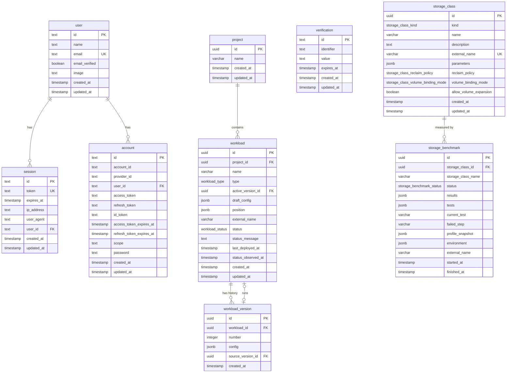

# Database

Acceleratio keeps control-plane state in PostgreSQL. The database belongs to the API: only
`apps/api` opens a connection, owns Drizzle table definitions, and runs migrations. The console in
`apps/frontend` is a browser application with no database of its own; it reads and writes through the
HTTP API and shares types through `packages/shared`. A query belongs in the API, never in the console.

## Where the schema lives

- `apps/api/src/vendor/db/schema.ts` — better-auth tables (`user`, `session`, `account`,
  `verification`). The library owns them, so they keep their camelCase keys and are not part of the
  domain modules.
- `apps/api/src/application/<module>/schemas/<name>.schema.ts` — domain tables, one file per module
  (`project.schema.ts`, `workload.schema.ts`). The module that serves a table owns its definition.
- `apps/api/drizzle.config.ts` — dialect, schema globs, and the output directory. It loads
  `src/vendor/db/schema.ts` plus `src/application/**/schemas/*.schema.ts`, so a new module schema is
  picked up automatically.
- `apps/api/drizzle/*.sql` — generated, forward-only migrations.
- `apps/api/drizzle/meta/` — Drizzle snapshots and `_journal.json`. These are generated; never edit
  them by hand.

Table conventions (naming, timestamps, indexes, delete behavior) are in
[FILE_STRUCTURE.md#schemas](./FILE_STRUCTURE.md#schemas). This document describes the model itself.

## Data model



## Tables

### `project`

One row per project. `id` is a server-generated UUID used in URLs and as the Kubernetes namespace
suffix. `name` is operator-visible and not unique. Deleting a project cascades to its workloads.

Columns: `id`, `name`, `created_at`, `updated_at`.

### `workload`

One row per deployable node on the project canvas. `project_id` scopes every read and write.

Columns: `id`, `project_id`, `name`, `type`, `active_version_id`, `draft_config`, `position`,
`external_name`, `storage_class_id`, `status`, `status_message`, `last_deployed_at`, `status_observed_at`, `created_at`,
`updated_at`.

Invariants:

- `(project_id, external_name)` is unique. `external_name` becomes the Kubernetes Deployment name,
  is generated once on create, and never changes.
- `type` selects the shape of every config of the workload (`draft_config` and its versions). The
  values are `docker` and `s3_bucket`. A `docker` config carries the image reference (`docker_image`) and optional
  `cpu_max` (vCPU, default 1), `ram_max` (MiB, default 1024), `entrypoint` and `command` (string
  arrays that replace the image's ENTRYPOINT and CMD). An absent limit means the default and a null
  limit means no limit. New services are created with both limits null; configs stored before that
  keep their 1 vCPU / 1 GiB default. Empty entrypoint/command lists are omitted, so older configs
  need no migration. Adding a type means adding an enum value and a config
  schema together.
- An `s3_bucket` workload is a SeaweedFS bucket. Its `name` and `external_name` are both the bucket
  name, which is unique across all projects (partial unique index `workload_s3_bucket_name_unique`,
  because SeaweedFS has one bucket namespace). Its config is `{ "storage_class_id": uuid }`, recorded
  once as version 1 and never changed; `storage_class_id` repeats it as a column so the storage
  profile cannot be deleted while a bucket uses it. It has no draft and no Deployment: the API sets
  its status from the provisioning Job (`deploying` until the bucket exists, then `running` or
  `failed`). The access keys live in the Secret `s3-<bucket>` in the project namespace, never in the
  database. For other types `storage_class_id` is null.
- The config lives in versions, not on the row. `active_version_id` points at the
  `workload_version` the cluster runs and is null until the first deploy. `draft_config` holds edits
  the next deploy applies and is null when there are none. At least one of the two is set: a new
  workload starts with a draft and no version. An edit back to the active config clears the draft.
- `position` is the canvas coordinate `{ "x": number, "y": number }`; both keys are required. The
  column default is `{ "x": 0, "y": 0 }`, while the API places new workloads in the first free slot of
  the project's four-column canvas grid. Existing rows that still sat at the origin were backfilled
  into the same grid.
- `status` starts as `draft` and is constrained by the `workload_status` enum. `status_message`
  carries the operator-facing explanation for the current status; `last_deployed_at` records when a
  deploy action last ran, not when the deployment finished rolling out. `status_observed_at` records
  when the workloads observer last wrote the status, so a row's freshness can be judged without
  reading the cluster; it is stored as `timestamp` without time zone, like the other timestamps, and
  is not used for ordering.
- `workload_project_id_idx` covers lookups by project. The unique constraint doubles as the index for
  the project plus deployment name pair.

### `workload_version`

An immutable snapshot of a config that was applied to the cluster. A row is written only after the
cluster accepted the Deployment and is never updated; deleting a workload cascades to its versions.

Columns: `id`, `workload_id`, `number`, `config`, `source_version_id`, `created_at`.

Invariants:

- `(workload_id, number)` is unique. Numbers start at 1 and grow by one; the deploy locks the
  workload row while it takes the next number.
- A deploy with a draft writes a new version; a deploy without one reapplies the active version and
  writes nothing. A rollback writes a new version with the old config and sets `source_version_id`
  to the version it copied, so history only grows.
- `created_at` is when the version was applied. The pod template carries the version id in the
  `acceleratio.io/workload-version-id` annotation, so the cluster shows which version runs.
- Workloads that were deployed before versions existed were backfilled with v1 holding their config at
  `last_deployed_at`; workloads never deployed got that config as their draft (migration `0007`).
  Migration `0008` then dropped `workload.config`.

### `storage_class`

One row per SeaweedFS-backed Kubernetes StorageClass the console knows about. The row is the stable
identity other resources reference; the StorageClass object in the cluster is what Kubernetes uses.

Columns: `id`, `kind`, `name`, `description`, `external_name`, `parameters`, `reclaim_policy`,
`volume_binding_mode`, `allow_volume_expansion`, `created_at`, `updated_at`.

Invariants:

- `kind` is `platform` for the installer's class and `custom` for classes created in the console. At
  most one platform row exists (`storage_class_platform_unique`, a partial unique index). The API
  inserts it idempotently on the first read, named after `PLATFORM_STORAGE_CLASS_NAME` (default
  `seaweedfs-storage`). Its settings columns stay null: the installer owns the object, so its
  settings are read from the cluster, and the API refuses to update or delete it.
- `external_name` is the StorageClass name, unique, generated once as `sc-<slug>-<id prefix>` and
  never changed.
- `parameters` (the SeaweedFS CSI tuning: `replication`, `disk_type`, `collection`, `ttl`,
  `cache_capacity_mb`, `concurrent_writers`, `chunk_size_limit_mb`, `writeback_cache`),
  `reclaim_policy` and `volume_binding_mode` are written on create and never updated. Kubernetes
  forbids changing them on an existing StorageClass, so the console duplicates a class instead.
  `name`, `description` and `allow_volume_expansion` can change; the last one is patched on the live
  object.
- Resources that pick a class (volumes, buckets) reference it with
  `storage_class_id uuid references storage_class(id) on delete restrict`. The restriction is the
  database half of the delete guard; the API also refuses to delete a class that PersistentVolumes,
  claims in the cluster or S3 buckets still use.

### `storage_benchmark`

One fio run against a temporary volume of a storage profile. Runs are the benchmark history and
outlive their profile: `storage_class_id` references `storage_class` with `ON DELETE SET NULL`, and
`storage_class_name` keeps the profile name from when the run started (migration `0011` backfilled
it). `status` follows `pending` → `running` → `succeeded` or `failed`; `results` holds random
read/write IOPS, sequential read/write MB/s and random latencies when it succeeded, and
`status_message` explains a failure. `external_name` is the Job and claim name in the benchmark
namespace. `tests` holds one entry per finished test (parameters, IOPS, bandwidth, latency
percentiles, errors and a per-second series capped at 120 points, about 2 KB per run), written as
each test finishes so a running benchmark shows progress; `current_test` names the test running now.
`failed_step` is `install`, `provision`, `start`, `results` or a test name. `profile_snapshot`
copies the profile's settings and `environment` the node count, storage servers and Kubernetes
version when the run started (migration `0012`; older runs leave them null). The partial unique
index `storage_benchmark_active_unique` allows only one `pending` or
`running` row, so one benchmark runs across the cluster at a time. The newest 200 finished runs are
kept; older ones are pruned when a run finishes.

### better-auth tables

`user`, `session`, `account`, and `verification` are written by better-auth, not by application code.
`user.email` and `session.token` are unique. `session.user_id` and `account.user_id` reference
`user.id` with `ON DELETE CASCADE`, and both columns have an index. `verification.identifier` is
indexed because lookups happen by identifier. Timestamps named `expires_at` are compared by the
library; do not repurpose them.

## Enums

| Enum | Values | Used by |
| --- | --- | --- |
| `workload_type` | `docker` | `workload.type` |
| `workload_status` | `draft`, `deploying`, `running`, `stopped`, `failed` | `workload.status` |
| `storage_class_kind` | `platform`, `custom` | `storage_class.kind` |
| `storage_class_reclaim_policy` | `Delete`, `Retain` | `storage_class.reclaim_policy` |
| `storage_benchmark_status` | `pending`, `running`, `succeeded`, `failed` | `storage_benchmark.status` |
| `storage_class_volume_binding_mode` | `Immediate`, `WaitForFirstConsumer` | `storage_class.volume_binding_mode` |

Enum values are part of the database contract. Add a value with a migration; never reorder or remove
one that has shipped.

## Migrations

Migrations are generated from the Drizzle schema and applied in order. The journal and snapshots
record what a database has seen, so the three artifacts move together.

After changing a schema file:

1. Run `bun run db:generate` in `apps/api`. Review the generated SQL: a dropped column or an
   unrequested type change means the schema edit was wrong.
2. Read the new `drizzle/000N_*.sql`, `drizzle/meta/000N_snapshot.json`, and the updated
   `drizzle/meta/_journal.json`. Commit all three in the same change as the schema edit.
3. Run `bun run db:check` to verify the journal, snapshots, and SQL files form one consistent chain.
   It does not need a database.
4. Run `bun run db:migrate` against a development database and confirm the application still starts.

Rules:

- Migrations are forward-only. Never edit a migration that has been applied anywhere; add a new one.
- Backfills must be idempotent and safe to rerun. Migration `0004` is the reference: it adds nullable
  columns, fills `external_name`, then sets `NOT NULL` and adds the unique constraint.
- `db:push` mutates a database without writing a migration. Use it only for a throwaway local
  database; never against a shared or deployed one.
- A migration that changes or drops data needs a rollback note in the pull request.

## Verifying a schema change

```bash
cd apps/api

# 1. The generated migration set matches the schema files.
bun run db:check

# 2. Migrations apply cleanly to an empty database.
createdb readiness_check
DATABASE_URL=postgresql://acceleratio@localhost:5432/readiness_check bun run db:migrate
psql -d readiness_check -c '\dt'

# 3. The application compiles against the new row types.
bun run build

# Clean up the scratch database.
dropdb readiness_check
```

`db:check` prints `Everything's fine` when the files are consistent. On drift it names the mismatch;
regenerate the affected migration rather than editing snapshots.

## Changing the model

- A new domain table goes in the owning module's `schemas/` folder, is exported with its inferred row
  type, and gets a migration in the same change.
- A new column on an existing table follows the same path; keep it nullable until the backfill has
  run when the table may already contain rows.
- Read paths return rows through the module's service and map them to the `packages/shared` contract.
  The console imports those types; it never imports Drizzle.
- The API contract and the database model are related but not identical: the contract is the public
  surface, the schema is storage. Change both deliberately.

## Frontend data model

The console has no database, no ORM, and no migrations. Its data model is the API contract in
`packages/shared/src/types/`, and every read or write goes through `apps/frontend/src/api/`. When a
table changes, update the contract and the console mapping; no database work happens in
`apps/frontend`.
